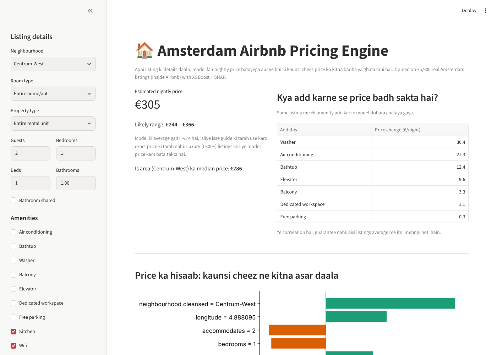
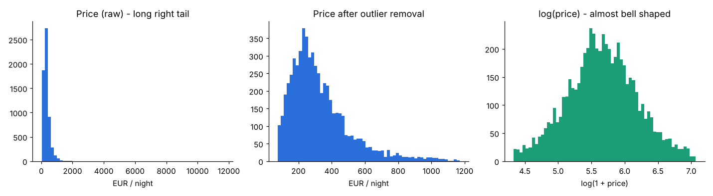
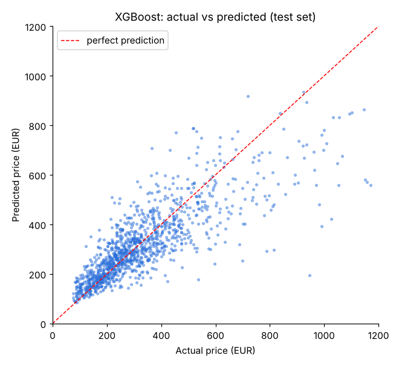
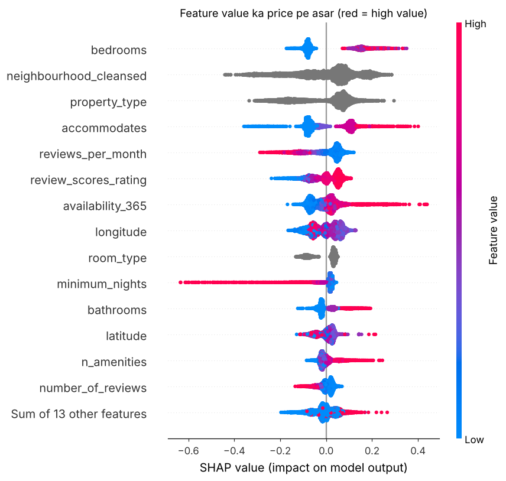

# Amsterdam Airbnb Pricing Engine

A machine learning app that predicts the nightly price of an Airbnb listing in Amsterdam and shows **which features push the price up or down**, so a host can see what they may be leaving on the table.

**Live demo:** _add your Streamlit link here after deploying_



## What it does

- Predicts a fair nightly price (EUR) from listing details: neighbourhood, room and property type, guests, bedrooms, bathrooms, amenities, host and review information.
- Explains every prediction with SHAP: a bar chart of how much each feature added or removed compared with the average listing.
- Runs "what if" checks: adds one missing amenity (AC, bathtub, washer, ...) to the listing and shows the estimated price change.

## Data

[Inside Airbnb](https://insideairbnb.com/get-the-data/), Amsterdam `listings.csv` (10,612 listings, 90 columns).

Cleaning (see `scripts/step1_clean.py`):

- 43% of rows had no price, so they were dropped. This left 6,039 rows.
- The cheapest and most expensive 1% were removed as outliers. This left 5,919 rows.
- `bathrooms` was empty, so it was rebuilt from `bathrooms_text` ("1.5 shared baths" becomes 1.5 plus a `shared_bath` flag).
- The amenities list was turned into a count plus 9 key flags.
- Missing review scores were filled with the median and a `no_reviews` flag was added.
- Rare property types (fewer than 30 listings) were grouped as "Other".



Price is right-skewed, so the model is trained on `log(price)`.

## Model

Models were compared on a held-out 20% test set:

| Model | MAE (EUR) | R² |
|---|---|---|
| Median guess | 135 | n/a |
| Ridge regression | 83.5 | 0.57 |
| Random Forest | 77.2 | 0.62 |
| **XGBoost** | **74.4** | **0.65** |

Early stopping used a separate validation split carved from the training data, so the test score is not leaked.



## What drives price (SHAP)

Average impact per listing: bedrooms (about EUR 32), neighbourhood (29), property type (27), guests (26), reviews per month (17).



## Limitations

- **Association, not causation.** The "add an amenity" estimates show what listings with that amenity cost on average. They do not prove adding it raises your price. For example, washers appear mostly in entire apartments, which are pricier anyway.
- **Prices are quotes for specific check-in dates**, so seasonality is baked in.
- **Luxury listings (EUR 600+) are under-predicted**, as there are few of them in the data.
- Photos, views and host quality are not in the data.

## Run locally

```bash
pip install -r requirements.txt
streamlit run app.py
```

To retrain, download `listings.csv` for any city from Inside Airbnb and run, in order:

```bash
python scripts/step1_clean.py
python scripts/step2_model.py
python scripts/step3_shap.py
```

## Stack

Python, pandas, scikit-learn, XGBoost, SHAP, Streamlit, matplotlib.
